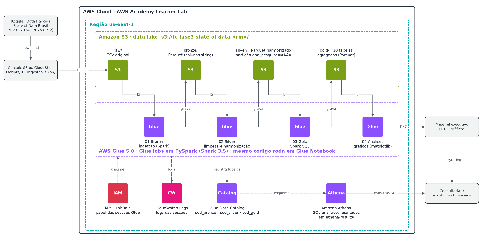

# Tech Challenge Fase 3 · Big Data to Analytics

**FIAP Pós Tech · Data Analytics (DTAT)**

Análise do mercado brasileiro de dados e IA com as três edições mais recentes da pesquisa
**State of Data Brasil** (Data Hackers e Bain & Company: 2023, 2024 e 2025). O público é uma consultoria
que assessora uma grande instituição financeira. O pipeline roda na AWS (S3, Glue e Athena) em arquitetura Medallion.

## Entregáveis

| Entregável | Arquivo |
|---|---|
| Apresentação executiva (35 slides com gráficos nativos e notas do apresentador) | [`entrega/TechChallenge_Fase3_DTAT.pptx`](entrega/TechChallenge_Fase3_DTAT.pptx) e [`.pdf`](entrega/TechChallenge_Fase3_DTAT.pdf) |
| Diagrama de arquitetura AWS (Draw.io) | [`arquitetura/arquitetura_aws.drawio`](arquitetura/arquitetura_aws.drawio) e [`.png`](arquitetura/arquitetura_aws.png) |
| Notebooks PySpark para o Glue | [`notebooks/ipynb/`](notebooks/ipynb/) (fontes em [`notebooks/*.py`](notebooks/)) |
| Consultas SQL do Athena | [`sql/02_consultas_analiticas.sql`](sql/02_consultas_analiticas.sql) e DDL em [`sql/01_athena_ddl.sql`](sql/01_athena_ddl.sql) |
| Roteiro de execução no AWS Academy | [`docs/ROTEIRO_AWS_ACADEMY.md`](docs/ROTEIRO_AWS_ACADEMY.md) |
| Evidências da execução na AWS (capturas do console) | [`entrega/evidencias/`](entrega/evidencias/) |

**Grupo 28** · Gabriel Zacharias · RM 375453

## Execução na AWS

O pipeline rodou na conta do AWS Academy Learner Lab (us-east-1) com o bucket `tc-fase3-state-of-data-rm375453`.

| Etapa | Resultado | Evidência |
|---|---|---|
| Ingestão no S3 | CSVs das 3 edições em `raw/edicao_<ano>/` (`.csv.gz`), zonas bronze/silver/gold/output/athena-results | [`01_s3_bucket_zonas.png`](entrega/evidencias/01_s3_bucket_zonas.png) |
| Glue Jobs 01 a 04 | 4 de 4 *Succeeded*, Glue 5.0, 2 workers G.1X, ~2 min cada, 0,29 DPU-hora no total | [`02_glue_jobs_succeeded.png`](entrega/evidencias/02_glue_jobs_succeeded.png) |
| Glue Data Catalog | `sod_bronze`, `sod_silver` e `sod_gold` (10 tabelas Gold) | [`03_glue_catalog_sod_gold.png`](entrega/evidencias/03_glue_catalog_sod_gold.png) |
| Athena | 16 de 16 consultas (Q0 a Q7b) com sucesso via [`scripts/run_athena.py`](scripts/run_athena.py), com os mesmos valores da validação local | [`04_athena_q7_financas.png`](entrega/evidencias/04_athena_q7_financas.png) |
| Gráficos | 15 PNGs gravados pelo job 04 em `output/charts/` | [`05_s3_output_charts.png`](entrega/evidencias/05_s3_output_charts.png) |

As capturas também estão nos slides 11 e 12 do deck.

## Requisitos do enunciado e onde cada um está atendido

| Requisito (enunciado) | Como foi atendido | Onde conferir |
|---|---|---|
| Dados do State of Data Brasil 2023, 2024 e 2025 (Kaggle) | 3 CSVs ingeridos sem alteração na zona `raw/` | `scripts/01_ingestao_s3.sh`, evidência 01 |
| Ambiente AWS Academy Learner Lab | Bucket, jobs, catálogo e Athena na conta do lab (us-east-1, LabRole) | `docs/ROTEIRO_AWS_ACADEMY.md`, `entrega/evidencias/` |
| Ingestão no S3 em zonas (Bronze/Silver/Gold) | Prefixos `raw/ bronze/ silver/ gold/`, Parquet Snappy, partição `ano_pesquisa` | Slides 5, 6 e 9; evidência 01 |
| ETL/ELT e catalogação com Glue Jobs | 4 Glue Jobs PySpark (`sod-01` a `sod-04`); `saveAsTable` registra `sod_bronze`, `sod_silver`, `sod_gold` | `notebooks/*.py`, evidências 02 e 03 |
| Consultas analíticas (Glue Notebook ou Athena) | 16 consultas Q0–Q7b no Athena, todas com sucesso | `sql/02_consultas_analiticas.sql`, `scripts/run_athena.py`, evidência 04 |
| Processamento com Spark | PySpark (DataFrame API + Spark SQL) nos 4 notebooks | Slides 7, 8 e 10 |
| Gráficos / DataViz | 15 gráficos gerados pelo job 04 (matplotlib, paleta segura para daltonismo) | `output/charts/`, slides 13 a 27 |
| 7 perguntas de negócio | Uma tabela Gold e um bloco de slides por pergunta | Slide 4 (agenda) e tabela abaixo |
| Apresentação executiva com storytelling | Pirâmide: mensagem principal → sumário → 7 perguntas → oportunidades → roadmap | `entrega/TechChallenge_Fase3_DTAT.pdf` |
| Diagrama de arquitetura em Draw.io, contido no deck | Arquivo `.drawio` com ícones oficiais AWS; PNG no slide 5 | `arquitetura/arquitetura_aws.drawio` |
| Scripts/notebooks entregues | Fontes `.py` (py:percent), `.ipynb` para o Glue, SQL do Athena e geradores auxiliares | `notebooks/`, `sql/`, `scripts/` |

## Conceitos do curso aplicados

| Conceito das aulas | Aplicação neste projeto |
|---|---|
| Data lake em camadas (bruta, limpa, transformada/curada) | `raw/` + Bronze = camada bruta; Silver = camada limpa (regras de qualidade, dedup, tipagem); Gold = camada curada, pronta para consumo |
| Organização do S3 por bucket + prefixo + objeto | Um bucket, um prefixo por camada e por tabela (`silver/respondentes/ano_pesquisa=2025/…`) |
| Glue Jobs (Spark/PySpark), Glue Data Catalog, Glue Notebooks | ETL nos jobs; catálogo central como metastore do Athena; o mesmo `.ipynb` roda em Glue Notebook |
| Athena: SQL serverless (Trino), paga por dado lido, integrado ao catálogo | Consultas direto sobre o Parquet catalogado; Q7 lê 0,84 KB em 0,4 s |
| Armazenamento colunar e compressão | Parquet com Snappy em todas as camadas processadas |
| Particionamento | Silver particionada por `ano_pesquisa` (Hive-style), poda de partições nos filtros por edição |
| ETL vs. ELT | ETL: a transformação acontece no Glue antes de carregar a Gold; o Athena consome o resultado |
| Processamento distribuído em memória (Spark, driver/executors, escala horizontal) | Glue 5.0 com 2 workers G.1X; DataFrame API (`select`, `filter`, `groupBy`, `agg`, `join`, `Window`, `explode`) e Spark SQL |
| Modelagem analítica (OLAP, tabelas agregadas) | 10 tabelas Gold com grão explícito, uma por pergunta de negócio |
| Serverless, pay-as-you-go, alta disponibilidade | Glue (0,29 DPU-hora no pipeline) e Athena, sem servidores para manter |
| Segurança e governança (IAM, criptografia, logs) | LabRole do Learner Lab, CloudWatch Logs dos jobs, criptografia padrão do S3; dados da pesquisa já anonimizados pela Data Hackers |
| 5 Vs do Big Data | Volume (14 mil respostas × ~400 colunas), Variedade (3 esquemas diferentes), Veracidade (regras de qualidade na Silver), Valor (7 respostas de negócio) |
| Evolução para lakehouse / orquestração | Próximos passos: Apache Iceberg (ACID, versionamento), Glue Workflows e QuickSight (slide 9) |

## Arquitetura



| Camada | S3 | Glue Catalog | O que acontece |
|---|---|---|---|
| Raw | `raw/edicao_<ano>/` | — | CSV original do Kaggle, sem alteração |
| Bronze | `bronze/` | `sod_bronze` | Parquet, nomes de coluna normalizados, colunas de auditoria e dicionário de perguntas |
| Silver | `silver/` | `sod_silver` | Modelo harmonizado entre anos (partição `ano_pesquisa`), faixas convertidas em valores e respostas múltiplas em formato longo |
| Gold | `gold/` | `sod_gold` | 10 tabelas agregadas, uma por pergunta de negócio |
| Consumo | `athena-results/`, `output/charts/` | — | Athena (SQL) e notebook de gráficos |

Ferramentas: Amazon S3, AWS Glue 5.0 (Spark 3.5) em Glue Jobs (o mesmo código roda em Glue Notebook), Glue Data Catalog, Amazon Athena, IAM LabRole e CloudWatch Logs.

## Perguntas respondidas

| # | Pergunta | Tabela Gold | Consulta |
|---|---|---|---|
| 1 | Estrutura do mercado | `distribuicao_perfil` | Q1, Q1b |
| 2 | Perfis mais valorizados | `salario_cargo_senioridade` | Q2, Q2b |
| 3 | Diversidade de gênero | `diversidade_genero` | Q3, Q3b |
| 4 | Adoção de tecnologias | `adocao_tecnologias` | Q4, Q4b |
| 5 | Adoção de IA e impacto | `adocao_ia`, `ia_impacto` | Q5, Q5b, Q5c |
| 6 | Região, senioridade e modelo de trabalho | `regiao_modelo_trabalho`, `modelo_trabalho` | Q6, Q6b |
| 7 | Oportunidades e desafios (recorte Finanças) | `comparativo_financas` | Q7, Q7b |

## Como executar

### Na AWS (entrega oficial)

Siga [`docs/ROTEIRO_AWS_ACADEMY.md`](docs/ROTEIRO_AWS_ACADEMY.md). Em resumo:

1. Inicie o Learner Lab (us-east-1) e abra o console AWS (o CloudShell usa as credenciais da sessão).
2. Envie os CSVs para `raw/` pelo console do S3 ou rode `SOD_BUCKET=<bucket> bash scripts/01_ingestao_s3.sh` no CloudShell.
3. Rode 01 a 03 como **Glue Jobs** (ETL e catalogação) e o 04 como Glue Job ou **Glue Notebook** (gráficos), todos com a
   **LabRole** e depois de trocar `BUCKET`. Na execução entregue, os quatro rodaram como Glue Jobs.
4. Consulte a Gold no Athena com `sql/02_consultas_analiticas.sql` (no editor ou com `python3 scripts/run_athena.py <bucket>`).

### Localmente (validação do mesmo código)

Os notebooks detectam se estão fora do Glue e usam PySpark local com as pastas `data/` e `output/`.

```bash
bash scripts/run_local.sh            # WSL/Linux: PySpark 3.5 + JDK 17, etapas 01 a 04
python scripts/run_sql_local.py      # roda o SQL do Athena com DuckDB sobre os Parquet locais
python scripts/build_notebooks.py    # .py (py:percent) -> notebooks/ipynb/*.ipynb
python scripts/gerar_ddl_athena.py   # gera sql/01_athena_ddl.sql a partir dos Parquet
python scripts/gerar_arquitetura.py  # gera o .drawio da arquitetura
python scripts/preparar_graficos_deck.py  # diagrama de arquitetura recortado para o deck
python scripts/exportar_dados_deck.py     # séries dos gráficos nativos do deck (Gold -> entrega/assets/dados_deck.json)
node scripts/gerar_deck.js                 # deck da FIAP; requer pptxgenjs (NODE_PATH) e PPTX_SKILL_DIR para aplicar o tema
node scripts/gerar_carrossel_linkedin.js   # versão curta em carrossel (entrega/linkedin/)
# fontes: Schibsted Grotesk e JetBrains Mono (Google Fonts, OFL) instaladas para o PDF sair fiel
```

## Estrutura

```
arquitetura/   diagrama Draw.io e PNG
data/          raw (CSVs do Kaggle) e camadas geradas localmente (não versionar)
docs/          roteiro de execução no AWS Academy
entrega/       deck PPTX/PDF e imagens usadas nele
notebooks/     pipeline PySpark (.py) e versões .ipynb para o Glue
output/        gráficos gerados pelo notebook 04
scripts/       ingestão, execução local, geradores de DDL, notebooks, arquitetura e deck
sql/           DDL e consultas do Athena
```

## Limitações

- O salário é o ponto médio da faixa declarada, e a faixa mais alta é aberta.
- A amostra é voluntária: é a comunidade Data Hackers, não um censo do mercado.
- O questionário muda entre edições. "Especialista" só existe em 2025, e as perguntas sobre IA na empresa vão apenas para gestores.
- Grupos pequenos, como Norte (n = 36) e quem não usa IA (n = 44), são só indicativos.
- As comparações entre grupos mostram correlação, não causa.

Fonte dos dados: [State of Data Brasil, Data Hackers no Kaggle](https://www.kaggle.com/organizations/datahackers).
